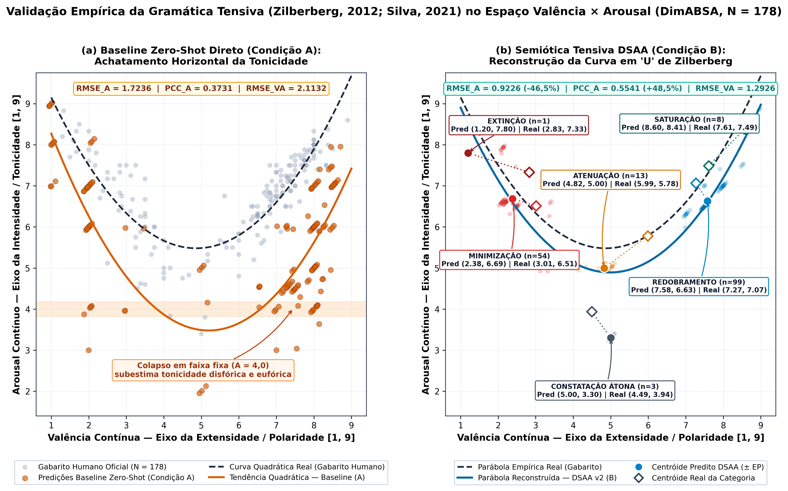
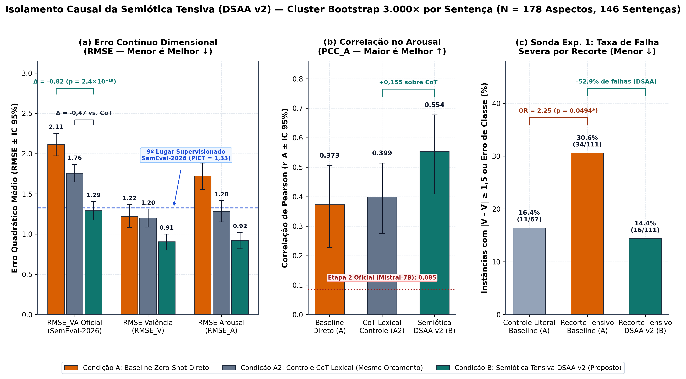
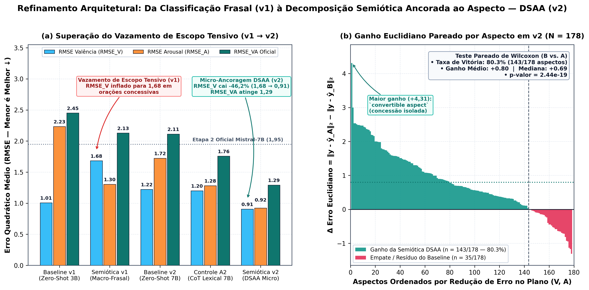
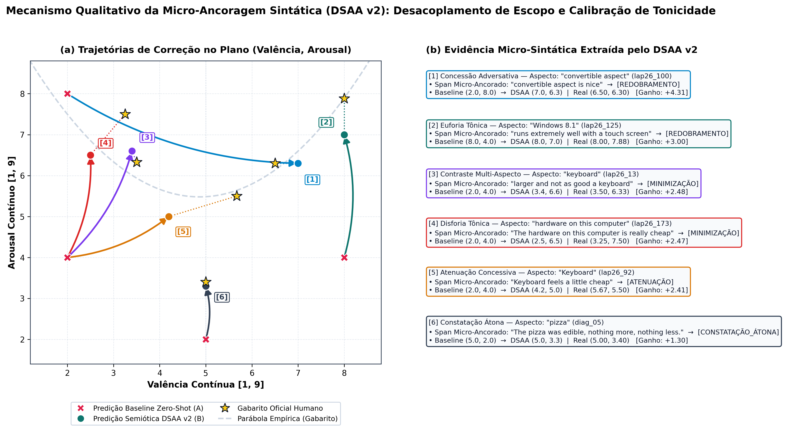

<div align="center">

# SemioABSA: Aspect-Anchored Tensive Semiotics for Dimensional Sentiment Analysis

**Bridging Claude Zilberberg's Tensive Semiotics & Large Language Models on SemEval-2026 DimABSA**

[](https://www.fflch.usp.br/)
[](https://aclanthology.org/2026.semeval-1.452/)
[-7C3AED?style=flat-square)](https://huggingface.co/Qwen/Qwen2.5-7B-Instruct)
[](docs/METHODOLOGY_AND_AUDIT.md)
[](requirements.txt)
[](https://colab.research.google.com/github/rosavinicius/semioabsa-usp/blob/main/notebooks/SemioABSA_DSAA_Colab_1Click.ipynb)
[](LICENSE)

**[🇬🇧 English (Current)](README.md)** · **[🇧🇷 Leia em Português](docs/README_PTBR.md)** · **[📄 Full Research Report (PDF, PT-BR)](docs/Relatorio_Final_IC_USP.pdf)** · **[🔬 Methodology & Forensic Audit](docs/METHODOLOGY_AND_AUDIT.md)** · **[📓 1-Click Colab Notebook](notebooks/SemioABSA_DSAA_Colab_1Click.ipynb)**

</div>

---

## 📌 TL;DR & Core Findings

Zero-shot Large Language Models (LLMs) excel at predicting **Valence** (satisfaction polarity) in Aspect-Based Sentiment Analysis (ABSA) but **systematically collapse along the Arousal (emotional intensity) axis**, clustering predictions around flat, uninformative bands (`A ≈ 4.0`, `PCC_A ≈ 0.08–0.37`).

In this undergraduate research conducted at **SemioCom / FFLCH — University of São Paulo (USP)**, we introduce **Aspect-Anchored Semiotic Decomposition (DSAA)**, operationalizing **Claude Zilberberg's Tensive Semiotics** (2006, 2012), **Luiz Tatit** (2011), and **Silva's (2021, 2023) six subjective quantifications** (`EXTINÇÃO`, `MINIMIZAÇÃO`, `CONSTATAÇÃO_ÁTONA`, `ATENUAÇÃO`, `REDOBRAMENTO`, `SATURAÇÃO`) as an explicit structural grammar for zero-shot LLM inference:

1. **Empirical Proof of Baseline Vulnerability (`p = 0.0494`):** Sentences exhibiting concessive tension, multi-aspect contrast, or figurative language **more than double** severe zero-shot baseline errors (`30.6%` vs. `16.4%` on literal controls; `Odds Ratio = 2.25`, Fisher's Exact Test). **DSAA cuts this failure rate in half to `14.4%` (`-52.9%` relative).**
2. **Causal Isolation Over Generic Chain-of-Thought (`p = 6.36e-18`):** Tested against **both** a Direct Zero-Shot Baseline (`Condition A`) and a matched-budget Lexical Chain-of-Thought Control (`Condition A2`) on `N = 178` leakage-free aspects (`146` unique sentences, `SEED = 2026`), **DSAA (`Condition B`) reduces official `RMSE_VA` by `-38.8%` (`2.1132 → 1.2926`) and outperforms Lexical CoT (`1.7571`) by `-26.4%`**, proving gains stem from semiotic theory rather than extra reasoning tokens.
3. **Matching Top-10 Supervised SemEval-2026 Systems Without Training:** On the strictly blind official SemEval-2026 dev splits (`rest26_*` + `lap26_*`, `N = 160`), zero-shot DSAA achieves **`RMSE_VA = 1.3033`**, surpassing 9th-place supervised fine-tuned `RoBERTa-Large` (`PICT = 1.3261`) with **zero gradient updates**.
4. **Empirical Reconstruction of Zilberberg's Parabolic U-Curve:** DSAA increases Arousal Pearson correlation from `0.3731` (`A`) and `0.3986` (`A2`) to **`0.5541`** (`80.3%` pairwise instance win-rate, Wilcoxon `p = 2.44e-19`), reconstructing the non-linear parabolic U-curve of human affect in `(Valence, Arousal)` space.

<p align="center">
  
</p>

---

## 📊 Main Empirical Results (`v2` Definitive Protocol, `SEED = 2026`)

Evaluated on `Qwen/Qwen2.5-7B-Instruct` (`4-bit NF4`, greedy deterministic decoding `do_sample=False`) across `N = 178` aspects (`160` official blind SemEval-2026 `rest26_*`/`lap26_*` dev instances + `18` canonical figurative/tensive diagnostic instances; **0% overlap** with training splits).

### Triple-Controlled Ablation (`Condition A` vs. `Condition A2` vs. `Condition B`)

| Scope / Metric | Cond. A (Direct Zero-Shot) | Cond. A2 (Matched Lexical CoT) | Cond. B (Semiotic DSAA v2) | Causal Gain `B vs. A` (`B vs. A2`) |
| :--- | :---: | :---: | :---: | :---: |
| **JSON Parse Coverage (`N = 178`)** | 100.0% | 100.0% | **100.0%** | `0` post-hoc guard fixes |
| **Global `RMSE_V` (Valence ↓)** | 1.2227 | 1.2010 | **0.9054** | **-25.9%** (`-24.6%` vs. CoT) |
| **Global `RMSE_A` (Arousal ↓)** | 1.7236 | 1.2826 | **0.9226** | **-46.5%** (`-28.1%` vs. CoT) |
| **Global `RMSE_VA` Official (↓)** | 2.1132 | 1.7571 | **1.2926** | **-38.8%** (`-26.4%` vs. CoT) |
| **Global `PCC_V` (Valence $r$ ↑)** | 0.9259 | **0.9371** | 0.9328 | `+0.0069` |
| **Global `PCC_A` (Arousal $r$ ↑)** | 0.3731 | 0.3986 | **0.5541** | **`+0.1810`** (`+0.1555` vs. CoT) |
| **Official Blind Dev (`N = 160`) `RMSE_VA` (↓)** | 2.1991 | 1.7930 | **1.3033** | **-40.7%** (`-27.3%` vs. CoT) |
| **Official Blind Dev (`N = 160`) `PCC_A` (↑)** | 0.2853 | 0.3628 | **0.4660** | **`+0.1807`** (`+0.1032` vs. CoT) |
| **Hard/Tensive Slice (`N = 111`) Macro-F1 (↑)** | 0.7188 | 0.7750 | **0.7805** | **`+0.0617`** on complex syntax |
| **Hard/Tensive Slice Severe Failure Rate (↓)** | 30.6% | 22.5% | **14.4%** | **-52.9% relative error drop** |

*Non-parametric significance (`3,000×` sentence-cluster bootstrap preserving intra-sentence correlation):*
- **`B` vs. `A`:** $\Delta\text{RMSE}_{VA} = -0.8213$, 95% CI `[-0.9820, -0.6574]`, `Prob(B < A) = 100.0%`, Pairwise Win-Rate = **`80.3%`** (`143/178`), Wilcoxon $p = 2.44 \times 10^{-19}$.
- **`B` vs. `A2` (Causal Semiotic Isolation):** $\Delta\text{RMSE}_{VA} = -0.4663$, 95% CI `[-0.5889, -0.3434]`, Pairwise Win-Rate = **`76.4%`**, Wilcoxon $p = 6.36 \times 10^{-18}$.

<p align="center">
  
</p>

---

## 🔬 Architectural Discovery: Solving *Tensive Scope Spillover* (`v1` → `v2`)

A critical methodological discovery of our project emerged between Generation `v1` (`results/v1_macro_sentence/`) and Generation `v2` (`results/v2_dsaa_definitive/`):

- **Macro-Sentence Spillover (`v1`):** Assigning a single tensive direction to a whole sentence before scoring an aspect caused `RMSE_V` to spike (`1.6822`), with **73.6% of squared Valence error originating in 6 concessive multi-aspect sentences** (e.g., classifying *"Although the aluminum chassis feels premium, the motherboard fried"* globally as `MINIMIZAÇÃO` contaminated the conceded aspect `aluminum chassis`).
- **Aspect-Anchored Micro-Syntactic Isolation (`v2` DSAA):** Requiring the LLM to extract the exact local clause governing the target aspect (`B_Evidencia_Micro_Aspecto`) *before* assigning Silva's (2021) tensive direction slashed `RMSE_V` by **`-46.2%` (`1.6822 → 0.9054`)** and collapsed `RMSE_VA` to **`1.2926`**.

<p align="center">
  
</p>

---

## 🔍 Explainable AI (XAI): Vector Corrections & Micro-Syntactic Spans

Beyond numerical regression accuracy, DSAA provides **intrinsic, human-aligned explainability**: every `(V, A)` coordinate is justified by an auditable micro-syntactic span and a theoretically grounded tensive category.

<p align="center">
  
</p>

---

## 🚀 Quickstart & 1-Click Reproduction

### Option A: Instant Statistical & Figure Verification on Any Laptop (CPU-only, `< 5 seconds`)

No GPU is required to audit all experimental CSVs, verify `0%` data leakage, recompute the `3,000×` sentence-cluster bootstrap confidence intervals, run unit tests, and regenerate all 300 DPI `.png` and vector `.pdf` figures:

```bash
git clone https://github.com/rosavinicius/semioabsa-usp.git
cd semioabsa-usp

# Install lightweight scientific stack
pip install -r requirements.txt

# 1. Run automated reproducibility & zero-leakage test suite
python3 -m unittest discover -s tests -v

# 2. Recompute all tables, Fisher/Wilcoxon tests, and 3,000x Cluster Bootstrap CIs
python3 scripts/verify_stats.py

# 3. Regenerate all 300 DPI PNG + vector PDF figures in assets/
python3 scripts/generate_figures.py
```

### Option B: Full Zero-Shot LLM Inference Reproduction on Google Colab (`T4` GPU)

Open [`notebooks/SemioABSA_DSAA_Colab_1Click.ipynb`](notebooks/SemioABSA_DSAA_Colab_1Click.ipynb) in Google Colab (Free Tier NVIDIA T4 16GB GPU) and click **`Runtime -> Run all`**:
- Automatically installs `transformers`, `accelerate`, and `bitsandbytes` (`4-bit NF4`).
- Automatically fetches official `DimABSA2026` blind development JSONL splits (`rest26_*` and `lap26_*`) with zero manual uploads.
- Executes deterministic greedy inference (`SEED = 2026`) across Conditions `A`, `A2`, and `B` (`DSAA v2`).

---

## 🗂️ Repository Structure

```text
semioabsa-usp/
├── .github/workflows/
│   └── verify_reproducibility.yml       # CI pipeline verifying stats, tests & 0% leakage on every push
├── assets/                              # 300 DPI PNG + editable TrueType vector PDF scientific figures
├── data/
│   ├── README.md                        # Data Card, split provenance & zero-leakage guarantee
│   └── diagnostic_suite_18.json         # Open-access 18-item figurative/tensive diagnostic suite (CC-BY 4.0)
├── docs/
│   ├── METHODOLOGY_AND_AUDIT.md         # Theoretical isomorphism, Tensive Scope Spillover & audit details
│   ├── README_PTBR.md                   # Complete Portuguese documentation
│   └── Relatorio_Final_IC_USP.pdf       # Full 13-page USP Final Scientific Report (PT-BR)
├── notebooks/
│   └── SemioABSA_DSAA_Colab_1Click.ipynb # 1-Click end-to-end Google Colab T4 notebook
├── results/
│   ├── semeval2026_official_submission/ # Official Codabench Track A Subtask 1 submission (RMSE_VA = 1.9483)
│   ├── v1_macro_sentence/               # Generation v1 outputs (N = 78, macro-sentence scope)
│   └── v2_dsaa_definitive/              # Definitive DSAA v2 outputs & report (N = 178, Seed = 2026)
├── scripts/
│   ├── generate_figures.py              # Reproduces Figures 1–4 in 300 DPI PNG + PDF
│   └── verify_stats.py                  # Instant CLI recomputing all metrics & 3,000x cluster bootstrap
├── src/
│   └── semioabsa_experiment.py          # Core experimental engine (Conditions A, A2, B + anti-leakage guard)
├── tests/
│   └── test_reproducibility.py          # Automated unit test suite (unittest / pytest compatible)
├── CITATION.cff                         # Machine-readable citation metadata for GitHub
├── LICENSE                              # MIT License (code) + CC-BY 4.0 (diagnostic suite & figures)
└── requirements.txt                     # Python dependencies
```

---

## ✅ ACL Rolling Review (ARR) Responsible NLP Reproducibility Checklist

- **Models & Parameters:** `Qwen/Qwen2.5-7B-Instruct` (7.6B parameters, 4-bit `NF4` quantization with `bfloat16`/`float16` compute dtype) for definitive `v2`; `Qwen/Qwen2.5-3B-Instruct` for `v1`; `mistralai/Mistral-7B-Instruct-v0.3` for official SemEval-2026 Stage 2 submission.
- **Compute Infrastructure & Runtime:** Single free-tier Google Colab `NVIDIA Tesla T4 (16GB VRAM)`; complete triple-condition (`A`, `A2`, `B`) inference over `N = 178` instances finishes in `~14 minutes`. Statistical verification and plotting run on CPU in `< 5 seconds`.
- **Determinism & Seeds:** Greedy deterministic decoding (`do_sample=False`, `temperature=None`); stratified sampling and `3,000×` sentence-cluster bootstrap fixed at `SEED = 2026`.
- **Evaluation Formula:** Official unnormalized SemEval-2026 Subtask 1 metric $\text{RMSE}_{VA} = \sqrt{\frac{1}{N}\sum_{i=1}^N [(V_i - \hat{V}_i)^2 + (A_i - \hat{A}_i)^2]}$, matching `DimABSA2026/evaluation_script/metrics_subtask_1_2_3.py`.
- **Transparent Limitation Reporting:** Section 4.3 of our report explicitly documents pragmatic over-amplification on colloquial English hyperbole within `SATURAÇÃO` (`n = 8`, mean Euclidean delta `-0.420`), highlighting psychometric compression in human ratings as a concrete avenue for future calibration.

---

## 📖 Citation

If you find **SemioABSA (DSAA)**, our empirical findings, or our diagnostic suite useful in your research, please cite:

```bibtex
@techreport{rosa2026semioabsa,
  title       = {Contribui{\c{c}}{\~o}es da Semi{\'o}tica para a An{\'a}lise Aspectual de Sentimentos: Decomposi{\c{c}}{\~a}o Semi{\'o}tica Ancorada ao Aspecto ({DSAA}) no Espa{\c{c}}o Val{\^e}ncia-Arousal},
  author      = {Rosa, Vinicius de Andrade and Silva, T{\'u}lio Ferreira Leite da and Beividas, Waldir},
  institution = {SemioCom, Faculdade de Filosofia, Letras e Ci{\^e}ncias Humanas -- Universidade de S{\~a}o Paulo (FFLCH-USP)},
  year        = {2026},
  address     = {S{\~a}o Paulo, Brazil}
}
```

Please also cite the foundational **Tensive Semiotics** framework and **SemEval-2026 DimABSA** benchmark:

```bibtex
@phdthesis{silva2021inteligencia,
  title  = {Intelig{\^e}ncia semi{\'o}tica e {TripAdvisor}: deep learning e quantifica{\c{c}}{\~o}es subjetivas na an{\'a}lise dos discursos de san{\c{c}}{\~a}o de restaurante},
  author = {Silva, T{\'u}lio Ferreira Leite da},
  school = {Faculdade de Filosofia, Letras e Ci{\^e}ncias Humanas, Universidade de S{\~a}o Paulo (USP)},
  year   = {2021}
}

@inproceedings{yu-etal-2026-semeval,
  title     = {{S}em{E}val-2026 Task 3: Dimensional Aspect-Based Sentiment Analysis ({D}im{ABSA})},
  author    = {Yu, Liang-Chih and Becker, Jonas and Muhammad, Shamsuddeen Hassan and Abdulmumin, Idris and Lee, Lung-Hao and Lin, Ying-Lung and Wang, Jin and Wahle, Jan Philip and Ruas, Terry and Chang, Kai-Wei and Mohammad, Saif M.},
  booktitle = {Proceedings of the 20th International Workshop on Semantic Evaluation (SemEval-2026)},
  year      = {2026},
  publisher = {Association for Computational Linguistics},
  pages     = {3753--3778},
  doi       = {10.18653/v1/2026.semeval-1.452}
}
```
