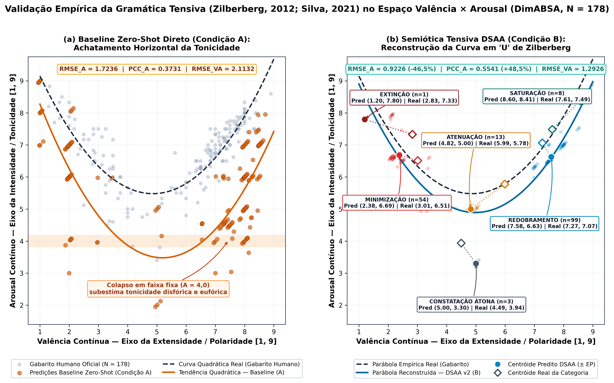
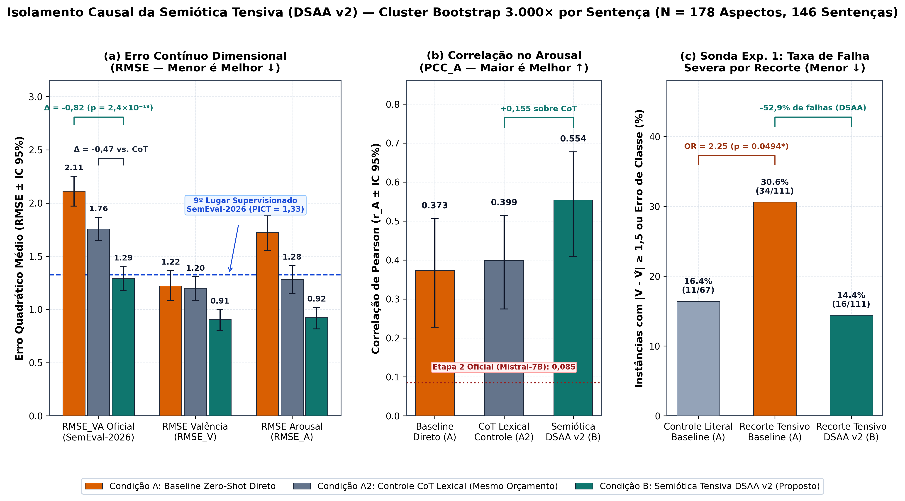
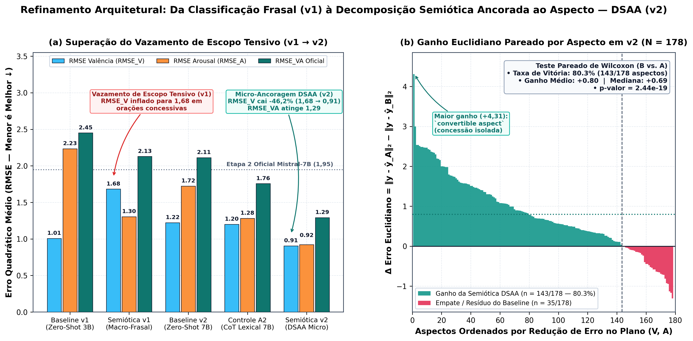
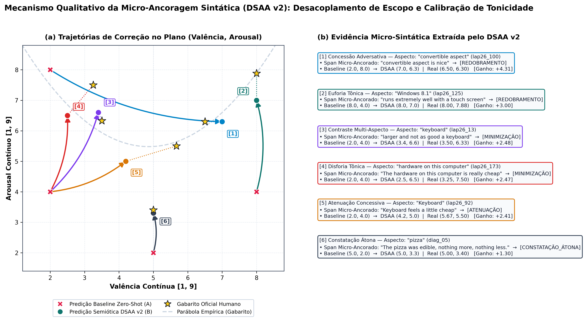

<div align="center">

# SemioABSA: Semiótica Tensiva Ancorada ao Aspecto para Análise Dimensional de Sentimentos

**Articulando a Gramática Tensiva de Claude Zilberberg e Grandes Modelos de Linguagem no SemEval-2026 DimABSA**

[](https://www.fflch.usp.br/)
[](https://aclanthology.org/2026.semeval-1.452/)
[](METHODOLOGY_AND_AUDIT.md)
[](https://colab.research.google.com/github/rosavinicius/semioabsa-usp/blob/main/notebooks/SemioABSA_DSAA_Colab_1Click.ipynb)
[](../LICENSE)

**[🇬🇧 Read in English](../README.md)** · **[🇧🇷 Português (Atual)](README_PTBR.md)** · **[📄 Relatório Científico Final USP (PDF)](Relatorio_Final_IC_USP.pdf)** · **[📓 Notebook Colab 1-Clique](../notebooks/SemioABSA_DSAA_Colab_1Click.ipynb)**

</div>

---

## 📌 Síntese Executiva e Principais Descobertas

Modelos de Linguagem de Grande Escala (LLMs) operando em regime *zero-shot* preveem bem o eixo de **Valência** (satisfação/polaridade) na Análise Aspectual de Sentimentos (ABSA), mas **colapsam sistematicamente no eixo de Arousal (intensidade/tonicidade afetiva)**, achatando suas predições em faixas estáticas (`A ≈ 4,0`; `PCC_A ≈ 0,08–0,37`).

Nesta Iniciação Científica desenvolvida no grupo **SemioCom / FFLCH — Universidade de São Paulo (USP)**, propomos e validamos a **Decomposição Semiótica Ancorada ao Aspecto (DSAA)**, operacionalizando a **Semiótica Tensiva** de Claude Zilberberg (2006, 2012), Luiz Tatit (2011) e as seis **quantificações subjetivas / direções tensivas** de Silva (2021, 2023) (`EXTINÇÃO`, `MINIMIZAÇÃO`, `CONSTATAÇÃO_ÁTONA`, `ATENUAÇÃO`, `REDOBRAMENTO` e `SATURAÇÃO`) na inferência estruturada de LLMs:

1. **Vulnerabilidade Comprovada do Baseline (`Fisher p = 0,0494`):** Sentenças com concessão sintática, contraste multi-aspecto ou linguagem figurativa **mais que dobram** a taxa de erro severo do baseline *zero-shot* (`30,6%` vs. `16,4%` em sentenças literais; `Odds Ratio = 2,25`). **O DSAA v2 reduz essa taxa de falha pela metade (`14,4%`, queda relativa de `-52,9%`).**
2. **Isolamento Causal sobre *Chain-of-Thought* Lexical (`p = 6,36e-18`):** Avaliado contra o Baseline Direto (`Condição A`) **e** contra um Controle *Chain-of-Thought* Lexical de idêntico orçamento computacional (`Condição A2`) em `N = 178` aspectos livres de vazamento (`146` sentenças, `SEED = 2026`), o **DSAA v2 (`Condição B`) reduz o `RMSE_VA` oficial em `-38,8%` (`2,1132 → 1,2926`) e supera o CoT lexical (`1,7571`) em `-26,4%`**, isolando o efeito específico da Semiótica.
3. **Fronteira do Top-10 Supervisionado do SemEval-2026 sem Treinamento:** Nas `160` instâncias cegas oficiais de desenvolvimento do SemEval-2026 (`rest26_*` e `lap26_*`), o DSAA v2 atinge **`RMSE_VA = 1,3033`**, superando o 9º colocado geral supervisionado (`PICT`, `RoBERTa-Large`, `1,3261`) **sem ajuste de pesos**.
4. **Reconstrução Empírica da Curva em "U" de Zilberberg:** O DSAA eleva a correlação de Pearson no *Arousal* para **`0,5541`** (`80,3%` de vitórias individuais, Teste de Wilcoxon `p = 2,44e-19`), reconstruindo a parábola real de tonicidade humana no plano `(Valência, Arousal)`.

<p align="center">
  
</p>

---

## 📊 Resultados Empíricos Consolidados (`v2` DSAA, `SEED = 2026`)

| Escopo / Métrica | Cond. A (Baseline Direto) | Cond. A2 (Controle CoT Lexical) | Cond. B (Semiótica DSAA v2) | Ganho `B vs. A` (`B vs. A2`) |
| :--- | :---: | :---: | :---: | :---: |
| **Cobertura JSON Válida (`N = 178`)** | 100,0% | 100,0% | **100,0%** | `0` correções pós-hoc |
| **Global `RMSE_V` (Valência ↓)** | 1,2227 | 1,2010 | **0,9054** | **-25,9%** (`-24,6%` vs. CoT) |
| **Global `RMSE_A` (Arousal ↓)** | 1,7236 | 1,2826 | **0,9226** | **-46,5%** (`-28,1%` vs. CoT) |
| **Global `RMSE_VA` Oficial (↓)** | 2,1132 | 1,7571 | **1,2926** | **-38,8%** (`-26,4%` vs. CoT) |
| **Global `PCC_V` (Correlação V ↑)** | 0,9259 | **0,9371** | 0,9328 | `+0,0069` |
| **Global `PCC_A` (Correlação A ↑)** | 0,3731 | 0,3986 | **0,5541** | **`+0,1810`** (`+0,1555` vs. CoT) |
| **Dev Cego Oficial (`N = 160`) `RMSE_VA` (↓)** | 2,1991 | 1,7930 | **1,3033** | **-40,7%** (`-27,3%` vs. CoT) |
| **Recorte Tensivo (`N = 111`) Taxa de Falha (↓)** | 30,6% | 22,5% | **14,4%** | **-52,9% relativo** |

<p align="center">
  
</p>

---

## 🔬 Superação do *Vazamento de Escopo Tensivo* (`v1` → `v2`) e Explicabilidade (XAI)

Na geração preliminar `v1` (`N = 78`), rotular a sentença inteira numa direção tensiva gerava contaminação em orações concessivas (*Tensive Scope Spillover*, `RMSE_V = 1,6822`). Na geração definitiva `v2` (DSAA), o isolamento prévio do *span* micro-sintático do aspecto derrubou `RMSE_V` em **`-46,2%` (`0,9054`)** e forneceu justificativas linguísticas auditáveis para cada coordenada `(V, A)`:

<p align="center">
  
</p>

<p align="center">
  
</p>

---

## 🚀 Como Reproduzir Localmente ou no Google Colab

```bash
git clone https://github.com/rosavinicius/semioabsa-usp.git
cd semioabsa-usp
pip install -r requirements.txt

# 1. Executar suíte automatizada de testes e verificação anti-vazamento
python3 -m unittest discover -s tests -v

# 2. Recalcular todas as tabelas, Cluster Bootstrap 3.000x, Fisher e Wilcoxon (< 2s em CPU)
python3 scripts/verify_stats.py

# 3. Regerar todas as figuras em 300 DPI (.png e .pdf vetorial)
python3 scripts/generate_figures.py
```

Para reexecutar a inferência completa no modelo `Qwen/Qwen2.5-7B-Instruct` (`4-bit NF4`) gratuitamente em GPU T4, abra [`../notebooks/SemioABSA_DSAA_Colab_1Click.ipynb`](../notebooks/SemioABSA_DSAA_Colab_1Click.ipynb) no Google Colab e clique em **`Ambiente de execução -> Executar tudo`**.
